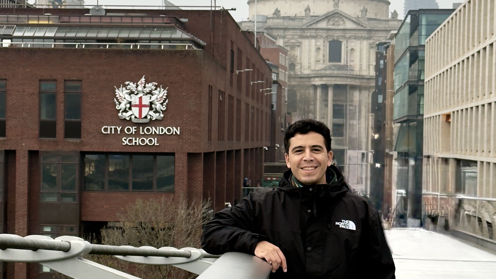

# Hello, I'm Omar

 I’m a Senior AI Engineer with strong interests in interpretability, alignment, and agentic systems. Lately, I've been obsessive about exploring how digital and biological brains work, brain organoids, and building my own startups in stealth mode.

## What I work on

1. _Building production-ready AI/ML systems (Agents, RAG, Evals, etc.)_
2. _Consulting and training in AI/ML for startups and companies_
3. _Creating technical content and developer docs_

Fun fact: I once worked as a [music](https://open.spotify.com/artist/5e6x7QJXOGbkDEPpEOWm1w) [producer](https://music.apple.com/us/artist/1600939432) and YouTube [content](https://www.youtube.com/watch?v=kFlLzFuslfQ) [creator](https://www.youtube.com/watch?v=ISa10TrJK7w). In my free time you can find me making beats, learning Mandarin (你好), or exploring new places around the world.

## Let's Connect

Reach out via [X], [LinkedIn], or [omar@olivares.cl] to discuss a project or just to chat about AI.

[X]: https://x.com/omarnomad
[LinkedIn]: https://www.linkedin.com/in/ofou
[omar@olivares.cl]: mailto:omar@olivares.cl
